# link-tiny v2: Indexed Store, IDF Hybrid Linking & Fast MCP Queries

## 1. Root Cause Analysis (Current Bottlenecks & Failures)

Measured on the live deployment (`~158.7k` code symbols, `~464` documents):

| Layer | Symptom on Live Deployment | Root Cause in Code |
| --- | --- | --- |
| **1. Data Extraction (`link_engine.py`)** | Step 1 takes minutes; runs 45–60 sequential Cypher queries every run even when only 1 file changed. `HttpEndpoint` / `Route` have `expected: 60, kept: 0`. `File` and VB6 `Control` labels are completely missing. `doc_missing` is `16,353,536` (`99.7%` SHA miss). | `_paged_rows` executes 2D windowed keyset paging (`count` + `min/max` + `id(p)`/`id(e)` range scans) across 14 sequential code labels + 2 doc traversals (`Paragraph` and `HAS_ENTITY`). No true incremental extraction: `dev sync link` re-reads 100% of both graphs every time. Endpoints use `route`/`url`/`path` or `file_path`, so requiring `n.name` + `n.source_file` drops 100% of endpoints. `doc_id` values without file extensions miss `build_doc_sha_index`. |
| **2. Link Algorithm (`normalizers.py`, `compute_fresh_pairs`)** | Generates **16,394,024 links** (**8.4 GB** `links.jsonl`) for a single project. Top matched names are noise (`Source`: 12.8k, `CODE`: 11.4k, `components`: 5.1k, `InitializeComponent`: 4k, `Frame1`: 2.5k, `on_submit_click`: 2k). | (1) `entity_mentions` from the doc graph bypass `looks_identifier`, injecting plain words (`Source`, `Code`, `Screen`) into symbol lookup. (2) Zero IDF / document-frequency cap: a boilerplate identifier (`InitializeComponent`, `CODE`, `lock_flag`) appearing in 800 files × 30 paragraphs emits 24,000 links. (3) Flat `score = 1.0` for all matches: local `Variable` and auto-generated `Field` controls tie with `Class`/`Function`/`File`. (4) `qualified_segments` + `split_identifier_words` index redundant suffix word tuples. |
| **3. Storage (`link_store.py`)** | `links.jsonl` is **8.4 GB** of repeated JSON keys. Step 4 loads all 16.4M lines into RAM (`>15 GB`), builds a 16.4M-entry dict, and re-scans it. | Flat append-only JSONL log with zero indexing and extreme string duplication (`project_id`, `doc_id`, `path`, `source_sha` repeated 16.4M times). |
| **4. MCP Query (`mcp_server.py`)** | `find_code_for_doc` and `find_doc_for_code` either **time out / OOM** or **return `[]` (empty)**. | (1) Every tool call invokes `_project_read_model()` → `link_store.latest_links()`, parsing all **8.4 GB (16.4M JSON lines)** from disk per request. (2) Exact equality filters (`record.doc.doc_id == doc_id` and `code.path == path`) fail whenever callers pass unflattened paths (`a/b.xlsx` vs `a__b.xlsx`), basenames (`Foo.vb` vs `src/mod/Foo.vb`), or document stems. (3) All scores equal `1.0`, so `top_k=20` sorts alphabetically by `code.path` and returns noise. (4) `paragraph_snippet` fires up to 20 sequential HTTP MCP sessions (60 HTTP POSTs) to `mind_mcp` at query time. |

---

## 2. Target Architecture (What to Read, How to Link, What to Store, How to Query)

```mermaid
flowchart LR
  subgraph Sources["1. Post-Ingest Stores (Read-Only)"]
    DG["Doc Graph / Qdrant<br/>Document, Paragraph, Entity"]
    CG["Code Graph / Qdrant<br/>File, Class, Function, Field, Control, Endpoint"]
    BL["Sync Baselines<br/>doc_shas + code_inventories"]
  end

  subgraph Engine["2. Incremental Link Pipeline (link_engine.py)"]
    D["Delta Detector<br/>Changed/Deleted SHA diff vs SQLite state"]
    EX["Batched Extractor<br/>Changed docs + Symbol DF index"]
    M["Multi-Tier Linker & Scorer<br/>Tier 1: File/Module Stem & Endpoint<br/>Tier 2: IDF-Weighted Exact Symbol<br/>Tier 3: Qdrant Hybrid Vector Rerank"]
  end

  subgraph Store["3. Indexed Store (links.db SQLite WAL)"]
    T1["docs & paragraphs<br/>(norm_doc_id, stem, redacted_snippet, sha)"]
    T2["symbols<br/>(norm_path, basename, name_key, kind, df, sha)"]
    T3["links + B-Tree / FTS5 Indexes<br/>(doc_id, para_id, symbol_id, score, provenance)"]
  end

  subgraph MCP["4. Fast Query Facade (link_mcp :8790)"]
    Q1["find_code_for_doc<br/>Exact/Suffix/Stem/FTS doc lookup + module aggregation"]
    Q2["find_doc_for_code<br/>Basename/Suffix path + qualified/short name lookup"]
    Q3["trace_status<br/>O(1) metadata & coverage query"]
  end

  Sources --> D --> EX --> M --> Store --> MCP
```

### 2.1 After Doc & Code are in VectorDB and GraphDB — How to Extract
1. **True Incremental Delta First**:
   - Compare baseline `doc_shas` and `code_folder_shas` against the `doc_sources` and `code_files` tables in `links.db` **before** reading full graphs.
   - If 0 docs and 0 code files changed, `dev sync link` completes in **`< 100 ms`** (0 graph queries).
   - If only $k$ docs changed (and 0 code files changed), reuse the persisted `symbols` table in `links.db` and read only the $k$ changed documents' paragraphs from the doc store!
   - If only $m$ code files changed, reload symbols only for those $m$ `file_path` entries (`WHERE n.file_path IN $paths`), update symbol document-frequencies (`df`), and re-evaluate only affected token keys.
2. **Fast Bulk Extraction (Cold Build / `--reconcile`)**:
   - **Doc side**: Read paragraphs + entity mentions in a single pass. Prefer scrolling the local/remote Qdrant `{project_id}_doc` payload (`source_id`, `paragraph_id`, `text`, `entity_mentions` are already bundled per point) or a single simple `id(p) > $last_id ORDER BY id(p) LIMIT 5000` cursor without the 2D `range_cypher`/`group_cypher` overhead. Pre-compute the redacted 240-char snippet at ingest/link time.
   - **Code side**: Replace the 14-label × 4-query `_paged_rows` loop with simple `id(n) > $last_id` keyset cursors (skipping labels with count 0 immediately), and include:
     - `File` (matching screen IDs / module file stems like `OrderSummaryForm`),
     - `Control` (VB6 designer controls),
     - Fixed endpoint projections (`coalesce(n.name, n.route, n.url, n.path, n.symbol_id)` and `coalesce(n.source_file, n.file_path, n.module_id)` so `HttpEndpoint` / `Route` are never dropped).
   - **Doc SHA Join Fix**: Index baseline doc files by `posix_rel`, `flatten(posix_rel)`, `flatten(posix_rel_without_ext)`, and `stem` (casefolded) so extensionless `source_id` values match `100%` of baseline SHAs.

### 2.2 How to Link & Score (Eliminating the 16.4M Combinatorial Explosion)
Instead of emitting every `(paragraph, symbol)` pair with `score = 1.0`, use a **3-tier precision + IDF scoring pipeline**:

1. **Token Hygiene & Stoplist Hardening**:
   - Apply `is_linkable_token` **and** identifier-shape / domain-token validation to both prose tokens and `entity_mentions` (blocking plain common English nouns extracted by YAKE/GLiNER like `"Source"`, `"Code"`, `"Screen"`, `"components"`, `"Value"` unless they are compound identifiers).
   - Expand `STOPWORDS` with UI/framework boilerplate (`initialize_component`, `dispose`, `components`, `sender`, `event_args`, generic function-key handlers `on_submit_click`/`enter`/`leave` unless scoped to a matched file).
2. **Global Symbol Frequency (`df`) & Ambiguity Cap**:
   - Compute `file_df(match_key)` = number of distinct code files defining a symbol with `match_key`.
   - **Hard Ambiguity Gate**: If a bare `Variable` or `Field` name appears in `> MAX_GENERIC_FIELD_FILES` (e.g., `> 15` files, like `CODE`, `Source`, `DEPT_CODE`, `Frame1`), **do not** emit uncontextualized global links across all 800 files. Only link a high-frequency `Field`/`Variable` when the paragraph or document **also** matches the enclosing `File` / `Class` / `Module` (Co-occurrence / File-Context Gate)!
3. **Composite Scoring Formula (`score` in `[0.0, 1.0]`)**:
   $$\text{score} = \text{ clamp}\Big(w_{\text{kind}} \cdot w_{\text{idf}}(\text{file\_df}) \cdot w_{\text{match}} + b_{\text{context}} + b_{\text{semantic}},\ 0.0,\ 1.0\Big)$$
   - **Symbol Kind Weight ($w_{\text{kind}}$)**:
     - `File` / `Class` / `Interface` / `Type` / `Enum` / `Endpoint`: `1.00`
     - `Function` / `Property` / `Constant`: `0.90`
     - `Control` / `Field` (designer control): `0.75`
     - `Variable`: `0.60`
   - **Inverse File Frequency ($w_{\text{idf}}$)**:
     - Unique in 1 file (`df = 1`): `1.0`
     - `df > 1`: $1 / (1 + 0.25 \ln(\text{df}))$ — symbols unique to 1 file outrank symbols repeated in 50 files.
   - **File/Document Context Affinity Bonus ($b_{\text{context}} = +0.20$)**:
     - Awarded when the document's `doc_id`/title or another high-specificity symbol in the same paragraph/document matches the code symbol's `file_path` stem or enclosing `Class`/`Module` (e.g., doc `...OrderSummaryForm...` linking to `Field` `grid_unit_col` inside `OrderSummaryForm.Designer.vb`).
   - **Top-$K$ Per-(Paragraph, Token) Pruning**:
     - After scoring, cap candidates per `(paragraph, token_key)` to `MAX_LINKS_PER_TOKEN = 10` (sorted by `score DESC`). This guarantees links stay `O(paragraphs)` (`~10k–50k` high-value links instead of `16.4M`).
4. **Tier 3 — Optional Vector / Semantic Link Enrichment (Qdrant)**:
   - For documents/paragraphs with low lexical coverage (or when `--semantic` / hybrid mode is enabled), query Qdrant `{project_id}` using the paragraph's existing vector from Qdrant `{project_id}_doc` (zero re-embedding cost when both collections share the unified embedding model!) to discover semantic `Function`/`Class`/`File` links (`provenance = "semantic-vector"` or `"hybrid-lexical+vector"`, threshold $\ge 0.78$).

### 2.3 What to Store (`links.db` — SQLite WAL)
Replace the multi-gigabyte `links.jsonl` scan with a normalized SQLite database `{instance_root}/links/{project_id}/links.db` (`PRAGMA journal_mode=WAL; PRAGMA synchronous=NORMAL;`):

| Table | Columns | Indexes | Purpose |
| --- | --- | --- | --- |
| `meta` | `key PRIMARY KEY, value_json` | PK | Stores `built_at`, `counts`, `coverage`, `sha_join`, `symbol_universe_by_label` (`trace_status` reads in `< 1 ms`). |
| `docs` | `doc_uid INTEGER PK, doc_id TEXT UNIQUE, norm_doc_id TEXT, rel_path TEXT, stem TEXT, source_sha TEXT` | `idx_docs_norm`, `idx_docs_stem`, `idx_docs_rel` | Resolves exact, flattened, unflattened path, suffix, or stem in `O(log N)`. |
| `paragraphs` | `para_uid INTEGER PK, doc_uid INTEGER, paragraph_id TEXT, snippet TEXT` | `UNIQUE(doc_uid, paragraph_id)`, FTS5 virtual table `paragraphs_fts(snippet, doc_id)` | Stores pre-redacted 240-char snippet so `link_mcp` needs **0 HTTP calls** to `mind_mcp` at query time. |
| `symbols` | `sym_uid INTEGER PK, path TEXT, norm_path TEXT, basename TEXT, file_stem TEXT, name TEXT, norm_name TEXT, match_key TEXT, qualified_name TEXT, target_type TEXT, label TEXT, parser_type TEXT, start_line INT, end_line INT, repo TEXT, source_sha TEXT, file_df INT` | `idx_sym_name`, `idx_sym_key`, `idx_sym_path`, `idx_sym_base`, `idx_sym_stem` | Compact symbol table (`~158k` rows ≈ `18 MB`), reusable across incremental doc syncs. |
| `links` | `doc_uid INT, para_uid INT, sym_uid INT, relation TEXT, provenance TEXT, score REAL, status TEXT, updated_at TEXT, PRIMARY KEY (para_uid, sym_uid)` | `idx_links_doc_score(doc_uid, status, score DESC)`, `idx_links_sym_score(sym_uid, status, score DESC)` | Normalized integer foreign keys (`~16 bytes/row` vs `512 bytes/line` in JSONL). |

> **Backward compatibility**: `state.json` is still written alongside `links.db` for external scripts/tests, and `link_store` keeps a lightweight adapter for legacy unit tests.

### 2.4 What & How to Query (`link_mcp` :8790)
1. **Zero Full-File Scans**:
   - `link_mcp` opens `links.db` in read-only SQLite mode (`?mode=ro`). Queries execute indexed SQL joins in **`1–5 ms`** with **`< 10 MB` RAM**.
2. **Flexible Multi-Resolution Parameter Matching (Why Queries Will Always Find Results)**:
   - `find_code_for_doc(project_id, doc_id, query, top_k, min_score)`:
     - **`doc_id` resolution waterfall**:
       1. Exact `doc_id` or casefolded `norm_doc_id`
       2. Flattened form `flatten_doc_rel(doc_id)` (so passing `folder/spec.xlsx` matches `folder__spec.xlsx`)
       3. Basename / stem match (`OrderSummaryForm_Spec.xlsx` or `OrderSummaryForm_Spec`)
       4. Substring / token match on `doc_id` (so passing `OrderSummaryForm` matches all spec docs for that screen!)
     - **`query` filter**: matches against symbol `name`, `qualified_name`, `path`, `doc_id`, **and** paragraph `snippet` (via FTS5 / token match).
     - **Deduplicated Symbol Ranking**: Groups multiple paragraph hits to the same `(code.path, code.name)` into a single ranked result with `hit_count`, `max_score`, `matched_paragraphs[]`, and the best `snippet`, instead of flooding `top_k=20` with 20 paragraphs pointing to the same variable!
   - `find_doc_for_code(project_id, path, name, top_k, min_score)`:
     - **`path` resolution waterfall**:
       1. Exact POSIX `path` (case-insensitive)
       2. Repo-prefix stripped / component-boundary suffix match (`s1/src/foo/Bar.vb` ↔ `src/foo/Bar.vb` ↔ `Bar.vb`)
       3. File stem match (`Bar` matches symbols in `Bar.vb`, `Bar.Designer.vb`)
     - **`name` resolution waterfall**:
       1. Exact symbol `name` or `qualified_name`
       2. Normalized `token_match_key(name)` (matches snake_case ↔ camelCase)
       3. Trailing segment of `qualified_name` (`Module1.grid_unit_col` → `grid_unit_col`)
       4. If only `path` is passed (no `name`), returns all documents linked to any symbol or file-stem in that file, ranked by aggregated score.
3. **Instant Snippets (Zero Upstream HTTP Bottleneck)**:
   - Snippets are read directly from `paragraphs.snippet` in `links.db` (already filtered through `.sensitive-terms`). HTTP calls to `mind_mcp` are only used as an optional fallback if `snippet` is null.

---

## 3. Implementation Phases

| Phase | File | Deliverable | Test Budget |
| --- | --- | --- | --- |
| 01 | [phase-01-sqlite-indexed-store.md](phase-01-sqlite-indexed-store.md) | Normalized SQLite WAL store (`links.db`) + `state.json` sync + compatibility facade in `link_store.py` | M |
| 02 | [phase-02-fast-incremental-extraction.md](phase-02-fast-incremental-extraction.md) | Fast cursor/Qdrant readers, `File`/`Control`/endpoint extraction fixes, extensionless `doc_sha` join, true incremental delta | M |
| 03 | [phase-03-idf-scored-hybrid-linking.md](phase-03-idf-scored-hybrid-linking.md) | Entity token hygiene, `file_df` IDF scoring, file-context co-occurrence gate, top-$K$ pruning, optional Qdrant vector rerank | L |
| 04 | [phase-04-submillisecond-mcp-queries.md](phase-04-submillisecond-mcp-queries.md) | Indexed SQLite query engine in `mcp_server.py`, multi-resolution `doc_id`/`path`/`name` waterfall, symbol aggregation, zero-HTTP snippets | M |
| 05 | [phase-05-migration-and-benchmarks.md](phase-05-migration-and-benchmarks.md) | Reconcile migration (cleanup 8.4 GB `links.jsonl`), benchmark suite, `docs/LINK_CONTRACT.md` v2 update | S |

## 4. Target Metrics (Before vs. After)

| Metric (on 158k-symbol / 464-doc project) | Before (v1) | After (v2 Target) |
| --- | --- | --- |
| Active links count | `16,394,024` (99% noise) | `~15,000 – 60,000` (high-precision, IDF-gated) |
| On-disk link store size | `8.4 GB` (`links.jsonl`) | `< 25 MB` (`links.db` SQLite WAL) |
| Full `--reconcile` build time | `~10–25 min` | `< 15 sec` |
| Incremental `dev sync link` (no changes) | `~2–5 min` (full re-read + 8.4 GB parse) | `< 0.1 sec` |
| Incremental `dev sync link` (1 doc edited) | `~2–5 min` | `< 1.0 sec` |
| `link_mcp` query latency (`find_code_for_doc` / `find_doc_for_code`) | `> 120 sec` (timeout / OOM) | `< 10 ms` (0 HTTP calls, indexed SQLite) |
| `doc_sha` join hit rate | `0.25%` (`40k / 16.4M`) | `>= 99%` |
| Endpoint keep rate (`HttpEndpoint` / `Route`) | `0%` (`0 / 120`) | `100%` (`120 / 120`) |
